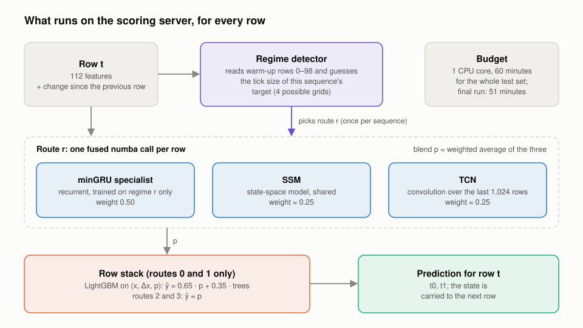
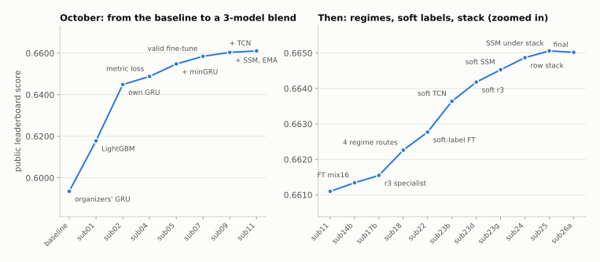

# Alpha Connectome (Wunder Fund): stateful sequence models under a 1-CPU latency budget

My solution to the Wunder Fund *Alpha Connectome* competition (Oct–Nov 2026). The task: predict two indicators
of future price moves (`t0`, `t1`) for one instrument from a 112-feature limit-order-book stream. Rows arrive one
at a time, so the model must be **stateful and causal**. Scoring runs on **one vCPU with a 60-minute limit** for
the whole test set, called once per row from Python.

**Result:** private LB **0.67220, rank 137 / 1448** (top 10 %). Best public 0.66506. The metric is the global
|y|-weighted Pearson correlation on a hidden subset of rows.

<picture>
  <source media="(prefers-color-scheme: dark)" srcset="docs/img/howitworks-dark.svg">
  
</picture>

**New to the problem? Start with the [illustrated write-up](docs/WRITEUP.md)**: it explains the task, the ideas
and the engineering in plain words, with diagrams and charts.

## Solution overview

<picture>
  <source media="(prefers-color-scheme: dark)" srcset="docs/img/inference-dark.svg">
  
</picture>

What worked, roughly in order of impact:

1. **Fine-tuning on the validation period** (3 epochs, lr 3e-4). Valid is closer in time to the test and carries
   the true `is_scored` mask. Row weights `need · (1 + 4·is_scored)` put more weight on scored rows. Apart from the
   switch from trees to neural networks, this was the largest single gain.
2. **Tick regimes.** Each sequence's target lives on its own grid `y = k·unit`, with one of four units. The regime
   can be read from the warm-up rows (99.9 % accuracy), so each regime gets its own specialist minGRU. The
   specialist has a **distributional tick-class head**: a softmax over `k`, whose metric-optimal point is
   `E[|y|·y] / E[|y|]`.
3. **Soft labels from a look-ahead teacher.** A GRU trained with *future* inputs (means of the next 2–50 rows; usable
   only in training) gives denoised targets. Every deployable member trains on `0.2·y + 0.8·teacher`, with row
   weights `|y| + 0.2`. Rows whose target is 0 still learn from the teacher.
4. **Metric-shaped loss.** |y|-weighted MSE plus `3 · (1 − weighted Pearson)` per chunk. Rows are also weighted by
   `P(is_scored)^0.5`, from a LightGBM mask model fitted on valid (train has no mask).
5. **Diverse members, then a row-level stack.** The members are a recurrent minGRU, a state-space model and a
   finite-window TCN. On the two fine-tick regimes, a LightGBM stack is fitted on out-of-fold valid predictions.
6. **An inference engine built for the budget.** All weights and state of a route sit in one numba `jitclass`
   (one call per row instead of ~70 array unboxings). Matrices are int16 with per-row scales (0.82× the float32
   time, same metric), and the SSM scan uses a division-free `exp`. Final server time: 51.4 of 60 minutes.

## Results

<picture>
  <source media="(prefers-color-scheme: dark)" srcset="docs/img/progress-dark.svg">
  
</picture>

| submission | change | public LB |
|---|---|---:|
| sub18 | regime routing with tick-class specialists | 0.66226 |
| sub22 | soft labels (look-ahead teacher) in the valid fine-tune | 0.66277 |
| sub23g | all members retrained from scratch on soft labels | 0.66453 |
| sub24 | LightGBM row stack on routes 0/1 | 0.66487 |
| sub25 | SSM kept in routes 0/1 under the stack | **0.66506** |
| sub26a (final) | r3 specialist on a shorter-horizon teacher (la25) | 0.66502 → private **0.67220** |

I chose my finals by the out-of-fold validation score (cross-fitted fine-tune halves), not by public LB.
Carry-over from validation gains to public LB was 35–60 %, and the public LB noise was of the same order as the late gains.

## Lessons

- **Use privileged train-time information early.** Soft labels from a look-ahead teacher (sub22 → sub23g, +0.0018
  public) came three weeks in, after many architecture rounds. Future rows exist in training even though the model
  can never see them at inference.
- **Look at the target before the model.** The four tick grids are in the raw target values. Finding them gave
  routing, tick-class heads and the specialists.
- **Capacity did not help.** A 2.8 M-parameter GRU teacher and wider members scored below the 128×2 members.
  Specialists trained from scratch beat specialists fine-tuned from a general trunk.
- **Gate every change on two independent halves.** Each change had to improve both cross-fit halves of valid. That
  rule rejected most ideas, all logged in `docs/EXPERIMENTS.md`. Even so, the final rank dropped from #120
  on public to #137 on private.
- **Latency is a modelling constraint.** The SSM was the strongest single member and the slowest. A faster `exp`
  saved 6 minutes on the server, and that time let the SSM back into two more routes (sub25).

## Repository

```
wnn/                     library
  nets.py                PyTorch members, losses, stateful chunked training loop (run_sequences)
  mingru_infer.py,       numba single-row mirrors of the members (int16 weights, wnn/quant.py)
  ssm_infer.py, tcn_infer.py
  fused.py               one-call-per-row runtime of a route (jitclass holding every array)
  regime.py, stack.py    regime detector and LightGBM row stack at inference
  ema_feats.py, fut_feats.py, features.py, data.py, trees.py, fastmath.py
scripts/
  train.py               train one member (teacher, specialist, SSM, TCN)
  teacher_label.py       teacher soft labels on train
  finetune_valid.py      valid fine-tune: cross-fit halves (out-of-fold) and full fit
  train_stack.py         row-level LightGBM stack
  build_pmask.py, fit_regimes.py   P(is_scored) weights, tick units + regime detector
  package.py             build and check the submission from configs/final.json
  local_eval.py          run a package exactly as the platform does and score it
submission/solution.py   entry point of the submission
pipeline/run_final.sh    every step, in order, with the final hyperparameters
tests/parity.py          bitwise comparison of two packages on valid sequences
docs/WRITEUP.md          illustrated plain-language write-up
docs/figures/            script that draws every figure in docs/img/
docs/EXPERIMENTS.md      lab notebook: every experiment, gate and dead end (partly in Spanish)
docs/REPRODUCE.md        how to rebuild the final submission
archive/                 research queues, gates and superseded scripts (do not run as is)
```

Data and model weights are not included. See `docs/REPRODUCE.md`. `utils.py` (the `DataPoint` callback and the
reference scorer) comes from the organizers' starter pack.

## License

MIT (see `LICENSE`) for my code. `utils.py` comes from the organizers' starter pack and is not covered by it.
