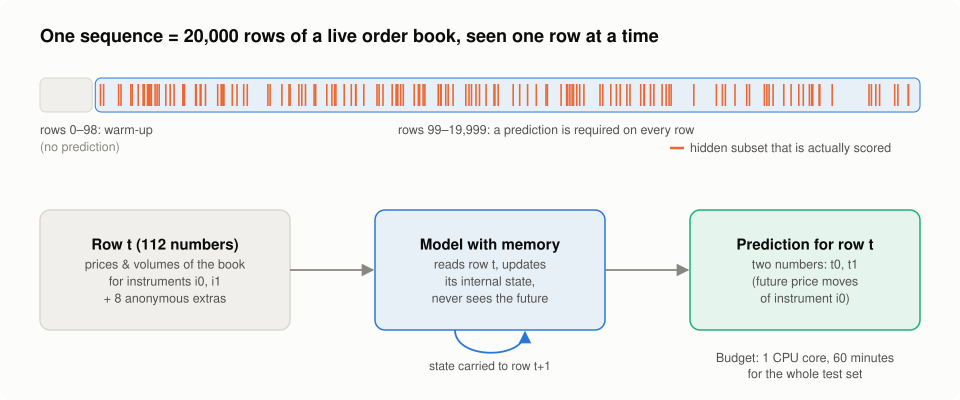
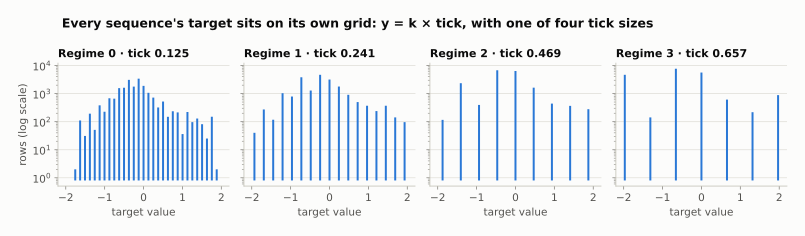
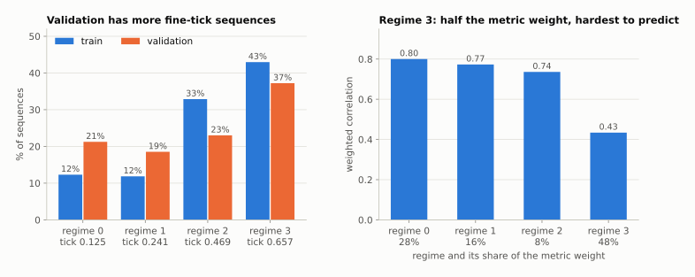
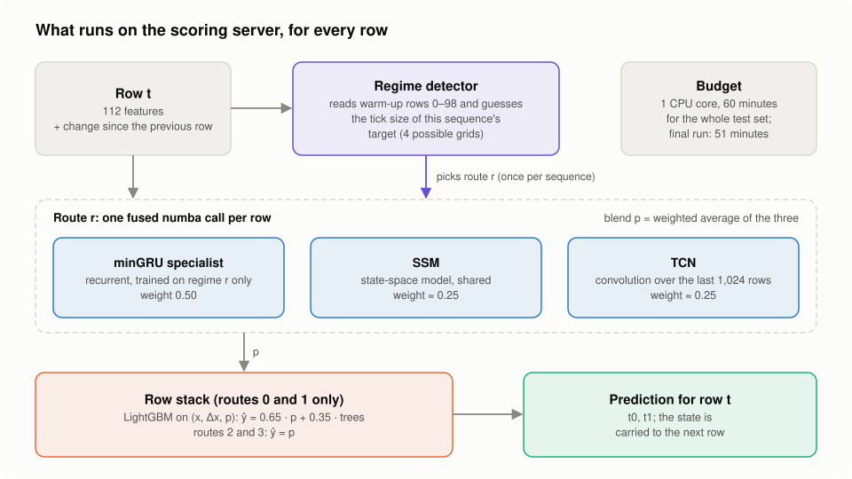
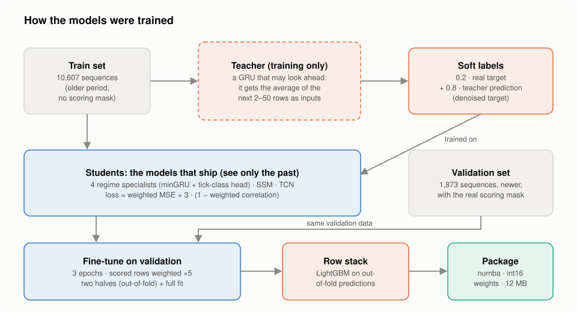
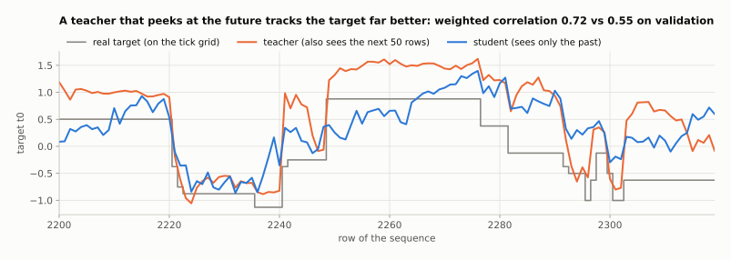
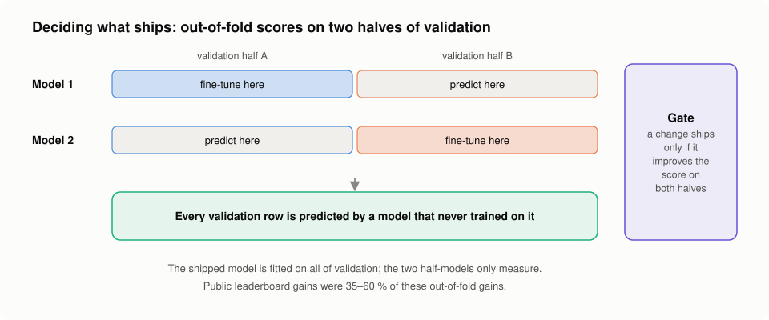
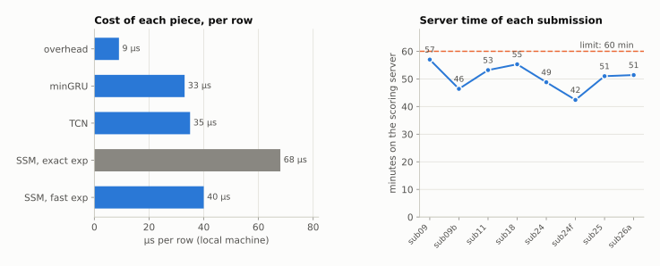
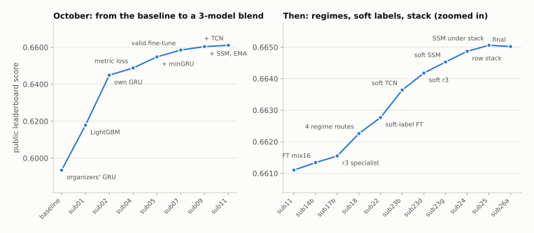

# Alpha Connectome: how the solution works

This document explains my solution to the **Alpha Connectome** competition organised by Wunder Fund
(October–November 2026). It is written for readers who know data science but have no context on this competition,
on finance, or on the models used. Every acronym is spelled out the first time it appears, and a
[glossary](#12-glossary-and-acronyms) at the end collects them.

- **Task**: Predict two continuous targets, row by row, from a stream of limit-order-book data
- **Final result**: Private leaderboard score **0.67220**, rank **137 of 1,448** teams (top 10 %)
- **Solution**: Regime-specific ensembles of three small neural sequence models, a gradient-boosted-tree correction, and knowledge distillation from a teacher that sees the future during training
- **Constraint**: The full test set must run in 60 minutes on one CPU (central processing unit) core; the final submission used 51 minutes

The figure below summarises the whole solution. The rest of the document explains each part in detail.

<picture>
  <source media="(prefers-color-scheme: dark)" srcset="img/howitworks-dark.svg">
  
</picture>

**Contents**

1. [The task](#1-the-task)
2. [Exploratory analysis: the target lives on a grid](#2-exploratory-analysis-the-target-lives-on-a-grid)
3. [Model architecture](#3-model-architecture)
4. [Training objective: optimise what is scored](#4-training-objective-optimise-what-is-scored)
5. [Soft labels from a teacher that sees the future](#5-soft-labels-from-a-teacher-that-sees-the-future)
6. [Fine-tuning on the validation period](#6-fine-tuning-on-the-validation-period)
7. [Model selection without trusting the public leaderboard](#7-model-selection-without-trusting-the-public-leaderboard)
8. [Inference engineering: 1 CPU core, 60 minutes](#8-inference-engineering-1-cpu-core-60-minutes)
9. [Results and timeline](#9-results-and-timeline)
10. [What did not work](#10-what-did-not-work)
11. [Lessons](#11-lessons)
12. [Glossary and acronyms](#12-glossary-and-acronyms)

---

## 1. The task

### 1.1 The data: limit-order-book snapshots

A **limit order book** is the list of all open orders to buy or sell an asset. Each order has a price and a quantity.
The best (highest) buy price is the **bid** and the best (lowest) sell price is the **ask**. The book changes every time
an order is placed, cancelled or filled.

The competition provides snapshots of the books of two instruments, called `i0` and `i1`. Each **row** has
**112 numeric features**:

| columns | count | content |
|---|---:|---|
| `i0_p0 … i0_p21`, `i0_v0 … i0_v21` | 44 | prices and volumes of the book of instrument `i0` |
| `i0_dp0 … i0_dp3`, `i0_dv0 … i0_dv3` | 8 | further price and volume columns of `i0` |
| the same 52 columns for `i1` | 52 | second instrument |
| `a0 … a7` | 8 | anonymous columns |

The columns are anonymised and transformed, so they are not raw quotes. Rows are grouped into **sequences** of
20,000 consecutive snapshots. Each sequence is predicted separately: the model's memory is reset at the start of
every sequence.

| split | sequences | period | is the scoring mask available? |
|---|---:|---|---|
| train | 10,607 | older | no |
| validation | 1,873 | newer | yes (`is_scored` column) |
| test | hidden | newest | no (scored on the competition server) |

### 1.2 The targets

Each row has two continuous targets, `t0` and `t1`. They describe the future price movement of instrument `i0`
relative to its current quotes. According to public notes by another participant, `t0` is a future reference price of
`i0` minus the current ask, and `t1` is the current bid minus that reference price. The targets are measured in the
future, so they are never available at prediction time.

### 1.3 The metric

For each target, the score is a **weighted Pearson correlation** between predictions `p` and targets `y`:

- Both `y` and `p` are clipped to [−2, 2].
- Row *i* has weight `w_i = |y_i|`, so rows with large moves count more and rows with `y = 0` count nothing.
- The correlation is computed **globally**, over all scored rows of all test sequences at once, not per sequence.

```
            Σ w (y − ȳ)(p − p̄)                           Σ w y           Σ w p
WP(y, p) = ─────────────────────────────── ,   with ȳ = ─────── ,  p̄ = ───────
           √( Σ w (y − ȳ)² · Σ w (p − p̄)² )             Σ w             Σ w

score = ( WP(t0) + WP(t1) ) / 2
```

Two consequences shaped the solution. A correlation is invariant to the scale of `p`, so only the direction and the
relative size of the predictions matter. And because the weights are `|y|`, the rows with big price moves dominate.

### 1.4 The evaluation protocol

<picture>
  <source media="(prefers-color-scheme: dark)" srcset="img/problem-dark.svg">
  
</picture>

- **Online, one row at a time.** The server calls `predict(row)` once per row, in order, and never shows a future
  row. A model must therefore be **causal** (use only the current and past rows) and **stateful** (keep its own memory
  of the past between calls).
- **Warm-up and scoring mask.** The first 99 rows of each sequence are a warm-up: the model sees them, but no prediction is required. After that, a
  prediction is required on every row, but only a hidden subset of rows is scored. The `is_scored` column shows
  this subset on validation only.
- **Compute budget.** The whole test set must be processed in **60 minutes on a single CPU core**, without a GPU
  (graphics processing unit), through the Python interface. Each row may therefore cost only on the order of 100 microseconds (µs),
  including the feature updates, every model and the Python call itself.
- **Leaderboards.** During the competition, a **public leaderboard** shows scores on part of the test data. The final
  ranking uses the **private leaderboard**, computed on the rest of the test data and revealed only at the end.

## 2. Exploratory analysis: the target lives on a grid

The most useful finding of the competition came from looking at raw target values, not from a model. Within a
sequence, every target value is an integer multiple of a fixed step, `y = k × tick`. The tick size takes only
**four** values across the whole dataset: 0.125, 0.241, 0.469 and 0.657.

<picture>
  <source media="(prefers-color-scheme: dark)" srcset="img/ticks-dark.svg">
  
</picture>

I call the four groups of sequences **regimes** 0 to 3, from the finest tick to the coarsest. Three facts made them
central to the solution:

- **The regime can be detected before the first prediction.** A multinomial logistic regression on summary
  statistics of the 99 warm-up rows identifies the regime of 99.9 % of validation sequences.
- **The regimes differ in difficulty and weight.** Regime 3 (coarsest tick) holds 48 % of the metric weight, because
  its target values are large, and it is by far the hardest to predict (right panel below).
- **The regime mix shifts over time.** In validation, the period closest to the test, 40 % of the sequences belong to
  the fine-tick regimes 0 and 1, against 24 % in train (left panel below).

<picture>
  <source media="(prefers-color-scheme: dark)" srcset="img/regimes-dark.svg">
  
</picture>

*Right panel: out-of-fold weighted correlation of an early ensemble (submission sub11) on the validation rows of each
regime.*

## 3. Model architecture

### 3.1 Overview: four routes, one per regime

At inference time, the warm-up rows select one of four **routes**, one per regime. The choice is made once per
sequence. Each route is an ensemble of three neural networks, optionally followed by a tree-based correction:

<picture>
  <source media="(prefers-color-scheme: dark)" srcset="img/inference-dark.svg">
  
</picture>

### 3.2 Inputs

Every network receives the first two input blocks below; the minGRU and the TCN also receive the third:

| input block | size | definition |
|---|---:|---|
| raw row `x_t` | 112 | the features as given |
| first difference `x_t − x_{t−1}` | 112 | change since the previous row |
| EMA z-score | 112 | `(x_t − m_t) / s_t`, where `m_t` and `s_t²` are the exponentially weighted mean and variance of the sequence so far (exponential moving average, EMA, with a span of 2,000 rows); clipped to [−5, 5] |

The EMA z-score tells the model whether a value is high or low *for this sequence*. This matters because levels
differ a lot between sequences. All three blocks are computed causally and updated incrementally, with the same code
in training and at inference.

### 3.3 The three networks

The three networks remember the past in different ways, so their errors are only partly correlated and their
average beats each of them alone.

| network | full name | size | how it summarises the past |
|---|---|---|---|
| **minGRU** | minimal Gated Recurrent Unit | 2 layers × 128 units | A recurrent hidden state updated at every row by a learned gate that decides how much to keep and how much to overwrite. It is a simplified GRU whose gate depends on the layer's current input but not on the previous hidden state, which makes it cheap to run. |
| **SSM** | selective State-Space Model (Mamba-style) | 2 layers × 128 units, state size 16 | A bank of linear memories that decay at learned, input-dependent rates. It behaves like many exponential moving averages whose time scales adapt to the data. |
| **TCN** | Temporal Convolutional Network | 10 layers × 64 channels | Stacked gated causal convolutions (kernel size 2) with dilations 1, 2, 4, …, 512, so each output sees a fixed window of the last 1,024 rows. It has no state beyond that window. |

Within a route, the predictions are averaged with fixed weights. The minGRU gets **0.50** and is a **specialist**,
trained only on sequences of that route's regime. The SSM and the TCN get **≈0.25** each and are shared by all four
routes (the exact weights differ slightly per target).

### 3.4 Tick-class output head (specialists)

Because the target lives on a known grid (Section 2), the specialist minGRU does not output a single number. It
outputs a probability distribution over the grid values `k × tick`: a softmax over the integers `k` covering
[−2, 2]. The prediction is the point that minimises the |y|-weighted squared error under that distribution:

```
ŷ = E[|y| · y] / E[|y|]        (expectations under the predicted distribution)
```

The head is trained with a cross-entropy loss on the observed `k`, added to the regression loss of Section 4.

### 3.5 Row-level stacking (routes 0 and 1)

On the two fine-tick routes, a **LightGBM** model (Light Gradient-Boosting Machine, a gradient-boosted decision-tree
library) corrects the ensemble. It uses 200 trees per target and takes the raw row `x_t`, its first difference, and
the ensemble prediction `p_t` as features. The final prediction is

```
ŷ_t = 0.65 · p_t + 0.35 · trees(x_t, Δx_t, p_t)
```

The stack is trained on **out-of-fold** predictions of the ensemble on validation (Section 7), so it never sees
predictions that were fitted on the same rows. On routes 2 and 3 the stack did not improve the score, and they use
`p_t` directly.

## 4. Training objective: optimise what is scored

Three design choices align training with the metric and the scoring mask. Each was worth more than any architecture
change.

**Metric-shaped loss.** Training processes whole sequences in **chunks** of 1,000–2,000 rows. The hidden state carries
from one chunk to the next, and gradients are cut at chunk borders (*truncated backpropagation through time*). On each
chunk, the loss is

```
loss = Σ w (ŷ − y)² / Σ w   +   3 · (1 − WP_chunk(y, ŷ))
```

The first term is a weighted MSE (mean squared error). The second is one minus the weighted Pearson correlation of
the chunk (Section 1.3). The weights are `w = |y| · r`: the factor `|y|` mirrors the metric, and `r` is the row
weight described next. The correlation term optimises the scored quantity directly. The MSE term anchors the scale of
the outputs, which a correlation alone leaves free.

**Row weights from the probability of being scored.** Only some rows are scored, and train has no scoring mask. A
LightGBM classifier is fitted on validation to predict `P(is_scored | row features)`, and then applied to train. The row
weight is `r = P(is_scored)^0.5`, so training focuses on rows similar to scored ones without discarding
the rest.

**Optimisation.** AdamW (Adam with decoupled weight decay, 10⁻⁴) with a one-cycle learning-rate schedule (peak
2 × 10⁻³). Mini-batches hold 24–32 sequences. Four of the five folds of train are used for fitting. The epoch with the
best mask-weighted correlation on the fifth fold is kept (early stopping).

<picture>
  <source media="(prefers-color-scheme: dark)" srcset="img/training-dark.svg">
  
</picture>

## 5. Soft labels from a teacher that sees the future

The target is noisy. It is quantised on a coarse grid and stays constant for long stretches, so many rows carry
little learning signal. The remedy was **knowledge distillation with privileged information**: a model that may use
information unavailable at test time trains the models that will be deployed.

1. **Teacher.** A standard GRU (2 layers × 128 units) is trained with extra **look-ahead inputs**. For each of the 52
   columns of `i0` and each horizon L ∈ {2, 5, 12, 25, 50}, it receives `mean(x_{t+1} … x_{t+L}) − x_t`: how the
   book will change over the next L rows. This uses future rows, so the teacher can only exist during training and is
   never submitted.
2. **The teacher is far more accurate.** Its weighted correlation on validation is **0.72**, against **0.55** for a
   causal student (the TCN, trained on train and before its fine-tune). Both are measured on every 8th validation sequence, target
   `t0`.
3. **Soft labels.** Every deployed model (a *student*) is trained on a blended target instead of the raw one:

   ```
   target_soft = 0.2 · y + 0.8 · teacher(x)          loss weight w = (|y| + 0.2) · r
   ```

   The additive 0.2 keeps rows with `y = 0` in training. With raw labels their weight `|y| · r` would be zero, but
   the teacher's prediction on them is still informative.

<picture>
  <source media="(prefers-color-scheme: dark)" srcset="img/teacher-dark.svg">
  
</picture>

*120 rows of one validation sequence. The teacher (orange) anticipates the steps of the real target (gray); the
causal student (blue) reacts later.*

Retraining every member from scratch on soft labels was the largest gain of the second half of the competition
(public score 0.66277 → 0.66453). On the validation out-of-fold score (Section 7), the coarse regime 3 worked best with a
teacher whose longest horizon was 25 rows instead of 50. The regime-2 specialist is the one exception: its soft-label retrain did not pass the selection rule
of Section 7, so it is trained on raw labels and gets soft labels only in the fine-tune.

## 6. Fine-tuning on the validation period

Validation is newer than train, closer in time to the test set, and it carries the real scoring mask. After the main
training, every network is therefore **fine-tuned** (trained further, with a small learning rate) on validation:

- 3 epochs, peak learning rate 3 × 10⁻⁴, mini-batches of 16 sequences, soft labels as in Section 5.
- Row weight `r = need_prediction · (1 + 4 · is_scored)`, used in the loss weight `(|y| + 0.2) · r` of Section 5:
  every row after the warm-up counts, and scored rows count 5×. On validation the true mask replaces the
  estimated `P(is_scored)`.

Apart from the initial switch from trees to neural networks, this was the largest single gain of the competition.
Training from scratch on train + validation, instead of fine-tuning, did not score better.

## 7. Model selection without trusting the public leaderboard

Late in the competition, improvements were in the range of 0.0002–0.0010. The public leaderboard uses only part of
the test data, and its noise is of the same order as these improvements, so it cannot rank them reliably. Decisions were therefore made
offline, by **cross-fitting** on validation:

<picture>
  <source media="(prefers-color-scheme: dark)" srcset="img/crossfit-dark.svg">
  
</picture>

1. Split the validation sequences into two halves, A and B.
2. Fine-tune one copy of each model on A and predict B, and another copy on B and predict A. Every validation row
   now has an **out-of-fold** (OOF) prediction from a model that never trained on it.
3. A change is accepted only if it improves the OOF score **on both halves**. Requiring two independent improvements
   filters out most noise.
4. The submitted model is fine-tuned on all of validation. The two half-models only measure, and also provide the
   OOF predictions on which the row stack (Section 3.5) is trained.

Most ideas failed this gate ([Section 10](#10-what-did-not-work)). The changes that passed carried over to the
public leaderboard at 35–60 % of their OOF gain. The last one (sub26a) came out flat on public (−0.00004, within the
noise). The final submission was chosen by OOF score, not by public score.

## 8. Inference engineering: 1 CPU core, 60 minutes

A standard deep-learning runtime (PyTorch, or ONNX, the Open Neural Network Exchange format) called once per row from
Python spends most of its time on per-call overhead, not on arithmetic. The submission therefore ships its own small
inference engine, written with **numba**, a just-in-time compiler that turns numeric Python into machine code:

- **One compiled call per row.** All weights and all recurrent states of a route live in a single compiled object.
  `predict(row)` makes one call into compiled code, instead of passing about 70 separate arrays between Python
  and compiled code on every row.
- **16-bit integer weights.** Weight matrices are stored as int16 with one floating-point scale per matrix row. This
  took 0.82× the time of 32-bit floats, with the same score.
- **A faster exponential function.** The SSM evaluates 4,096 exponentials per row. A division-free approximation
  (absolute error 8 × 10⁻⁸) cut the SSM's cost from about 68 to about 40 µs per row.
- **Automatic checks before every submission.** The numba engine must match the PyTorch models to about 10⁻⁵ on
  real sequences, and the trees must match LightGBM exactly. Latency is measured locally and converted to an estimate
  of the server time.

<picture>
  <source media="(prefers-color-scheme: dark)" srcset="img/latency-dark.svg">
  
</picture>

Speed was reinvested as soon as it was won. The fast exponential saved 6 minutes on the server. That time allowed the
SSM, the strongest but slowest member, to return to routes 0 and 1. That change produced the best public score
(sub25, 0.66506).

## 9. Results and timeline

<picture>
  <source media="(prefers-color-scheme: dark)" srcset="img/progress-dark.svg">
  
</picture>

*Chart labels: "sub" = submission; FT = fine-tune on validation; "FT mix16" = an intermediate fine-tune that weighted
scored rows more heavily (the final models use 5×); r3 = regime 3; "soft" = member retrained on soft labels.*

- **October (left panel).** The organizers' baseline (a GRU exported to ONNX, 0.5935) was replaced by a LightGBM model
  (0.6178), then by my own GRU (0.6449). Next came the metric-shaped loss with row weights, a second architecture,
  the validation fine-tune, the EMA inputs with the SSM, and the TCN (0.6611).
- **Late October to November (right panel, zoomed).** Regime routing with specialists (0.66226), soft labels member
  by member (0.66453), the row stack (0.66487) and the SSM under the stack (0.66506). Each step was worth
  0.0002–0.0009, and the 60-minute budget limited what could be added.
- **Final.** The selected submission (sub26a) scored 0.66502 on the public leaderboard and **0.67220 on the private
  leaderboard**: rank 137 of 1,448. Its public rank had been 120. For reference, 8th place scored 0.68566 and 100th
  place 0.67419.

Training the final models takes about 16 hours on one laptop GPU (NVIDIA RTX A1000, 4 GB), and about a day end to
end. [REPRODUCE.md](REPRODUCE.md) lists every step.

## 10. What did not work

The lab notebook ([EXPERIMENTS.md](EXPERIMENTS.md), section numbers in parentheses) records every experiment. Most
failed the two-halves gate of Section 7:

- **More capacity.** Wider GRUs (2 × 256), a 2.8-million-parameter teacher, and a per-row encoder in front of the
  minGRU (§18) scored at or below the 2 × 128 models.
- **Gains erased by the fine-tune.** Richer input representations (§17), longer EMA memories (§20) and an auxiliary
  "will the price move?" output (§21) improved models trained on train, but the gain disappeared after the
  validation fine-tune.
- **Distilling from the ensemble itself.** Soft labels made from the final ensemble pulled each member toward that
  ensemble, and the ensemble lost diversity (§28).
- **Adapting to the test period.** Per-regime rescaling (§42), a teacher fine-tuned on validation (§38) and
  per-sequence online calibration (§26) recovered nothing. The models were already well calibrated across periods.
- **A leak in disguise.** Delayed teacher labels looked very strong until I found that they share the same future
  reference price as the current target (§39). The gain came from future information, so the idea was invalid.
- **Pretrain, then specialise.** Specialists fine-tuned from a general network lost to specialists trained from
  scratch on their own regime (§48).
- **Reverse-engineering the anonymised columns** into true quotes (§43) was not achievable in the time left.

## 11. Lessons

1. **Look at the target before modelling.** The four tick grids were visible in the raw target values from day one.
   Finding them led to routing, tick-class heads and specialists.
2. **Use information that exists only at training time.** Future rows cannot be used at inference, but they can train
   a teacher. I found this three weeks into the competition; it should have been one of the first ideas.
3. **Align training with evaluation first.** The metric-shaped loss, the scoring-probability weights and the
   validation fine-tune each beat every architecture change.
4. **Decide offline, on independent halves.** The public leaderboard was too noisy to rank small changes. Even so,
   the final rank dropped from 120 (public) to 137 (private). The private score is computed on different test
   rows, and small public differences between teams do not carry over to it.
5. **Treat latency as a modelling resource.** Each microsecond saved could be spent on a stronger model.

## 12. Glossary and acronyms

| term | meaning |
|---|---|
| **ask / bid** | lowest price at which someone offers to sell / highest price at which someone offers to buy |
| **AdamW** | Adam optimiser with decoupled weight decay |
| **causal model** | a model whose prediction at row *t* uses only rows ≤ *t* |
| **cross-fitting** | fitting on one part of the data and predicting another, rotating the parts, so that every prediction is out-of-fold |
| **CPU / GPU** | central processing unit / graphics processing unit |
| **distillation** | training a model (the *student*) to reproduce the outputs of another model (the *teacher*) |
| **EMA** | exponential moving average: a running average in which older values decay geometrically |
| **fine-tuning** | continuing to train an already trained model on new data, usually with a smaller learning rate |
| **GRU / minGRU** | Gated Recurrent Unit, a recurrent neural network with learned gates; minGRU is a simplified version whose gate does not depend on the previous hidden state |
| **int16** | 16-bit signed integer, used here to store weights compactly |
| **LightGBM** | Light Gradient-Boosting Machine, a library for gradient-boosted decision trees |
| **limit order book** | the list of open buy and sell orders for an asset, with their prices and quantities |
| **MSE** | mean squared error |
| **numba** | a just-in-time compiler that turns numeric Python code into machine code |
| **ONNX** | Open Neural Network Exchange, a portable format for neural networks |
| **OOF** | out-of-fold: a prediction made by a model that did not train on that data point |
| **privileged information** | information available during training but not at prediction time (here, future rows) |
| **public / private leaderboard** | rankings on two disjoint parts of the test data; the public one is visible during the competition, the private one decides the final ranking |
| **regime** | one of the four tick sizes a sequence's target can have |
| **route** | the set of models used for one regime |
| **soft label** | a training target that blends the real target with a teacher's prediction |
| **SSM** | State-Space Model; a *selective* SSM (as in Mamba) makes its memory decay rates depend on the input |
| **stacking** | training a second-level model on the predictions of first-level models |
| **stateful model** | a model that keeps a memory from one call to the next |
| **TCN** | Temporal Convolutional Network: stacked causal, dilated 1-D convolutions over time |
| **tick** | the smallest step by which the target of a given sequence can change |
| **truncated BPTT** | truncated backpropagation through time: gradients flow only within a chunk of the sequence, while the hidden state carries across chunks |
| **WP** | weighted Pearson correlation, the competition metric (Section 1.3) |
| **µs** | microsecond, one millionth of a second |

---

Every figure is generated by [`docs/figures/make_figures.py`](figures/make_figures.py): the diagrams from code, the
charts from the competition data and from the numbers recorded in the lab notebook.
